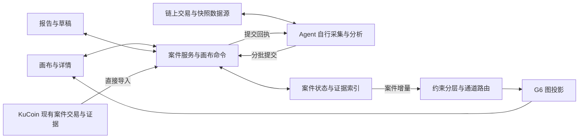

# Agent 资金流画布 · 需求与开发计划

产品讨论已完成 · 2026-11-23 · 画布基础、KuCoin 直导、互动报告、Ethereum 首轮调查和实绘几何已验证

调查员提供起始地址或交易哈希后，Agent 自行采集链上数据、核对证据并分析资金路径。每批分析结果通过校验后，画布同步增加节点、交易边和证据引用。调查员可以在调查过程中查看逐笔转账、添加备注、与 Agent 讨论当前选中对象，并在右侧报告定位证据。

## 首版范围

| 已确认事项 | 首版行为 |
| --- | --- |
| 新案件由 Agent 调查 | Agent 使用采集工具获取地址、逐笔转账、证据和可用的余额及报价。分析过程中逐批提交结果，画布同步更新。 |
| KuCoin 案件样例 | 使用当前 v4 报告和账本重建图数据，导入交易、地址和证据。默认打开核心视图，提供全量、原图数据、公开回流及 D1–D8。可直接打开打包后的离线画布。 |
| Agent 可直接操作画布 | 定位、筛选和排版可以直接执行。改变地址的实体归属或修改报告结论时，先展示差异并由用户确认。 |
| 互动报告与草稿 | 沿用 KOL 的章节及证据结构，画布与报告可双向定位。用户和 Agent 都可以创建带引用的草稿。 |

本计划采用桌面双栏、G6 5.1.1、本地单用户环境作为实现基线。交易边采用曲线平滑过渡至水平直线的组合路径，拖动时调整弯折控制点。全量报告编辑器和多人协作进入后续阶段，工期另估。

## 同类产品与现有实现

| 参考 | 核对到的产品能力与本项目用法 |
| --- | --- |
| BlockSec MetaSleuth | 地址节点有阅读与分析状态，地址和边各有左侧详情。同方向、同资产的转账可汇成单条边并逐笔展开。工具箱包含地址、代币筛选、添加地址或交易、备注和画布搜索。采用这些操作语义，并按图 2 统一节点模型，按图 3 保留时间与金额摘要。[节点](https://docs.metasleuth.io/user-manual/getting-started/what-are-nodes) · [边](https://docs.metasleuth.io/user-manual/getting-started/what-are-edges) · [工具箱](https://docs.metasleuth.io/user-manual/canvas-and-panels/canvas/toolbox-overview) · [地址详情](https://docs.metasleuth.io/user-manual/canvas-and-panels/address-panel) · [边详情](https://docs.metasleuth.io/user-manual/canvas-and-panels/edge-panel) |
| TRM Graph Visualizer | 支持把一组地址画成自定义实体，也可逐地址绘制。选中的转账和地址可以汇总交易金额及组合余额。采用实体与成员两种视图，并在详情显示汇总口径。[TRM 产品更新](https://www.trmlabs.com/resources/blog/january-product-highlights-accelerating-investigations-with-intuitive-workflows) |
| Chainalysis Reactor 与 Chain | Reactor 的资产选择可高亮匹配簇并将其余图形变淡，以保留路径上下文。Chain 官方页面描述了嵌入式对话和经人工复核的图、报告草稿。采用临时高亮来定位证据，时间和资产筛选按实际命中重算。[Reactor 资产高亮](https://www.chainalysis.com/blog/cross-chain-investigations/) · [Chain 产品页](https://www.chainalysis.com/chain/) |
| AML-Canva KuCoin | G6 5.1.1 已实现本地离线画布、方向和代币聚合、地址与哈希搜索、节点拖拽、平行边摘要和证据明细。以现有案件数据生成样例。全量视图含 1,748 个地址、2,475 条聚合边和 6,314 条转账，核心视图有 182 个地址、285 条边和 1,307 条转账。[案例说明](../../../AML-Canva/case/README.md) · [案件数据](../../../AML-Canva/case/fund-flow-data.json) · [原型实现](../../../AML-Canva/case/app.js) |
| KOL-001 v4 | 报告含章节、时间线、地址档案、逐笔证据和出处。已有从图边展开对应证据行的交互。已核对 AML 的 6,305 条带证据编号的记录均能匹配报告锚点，另 9 条仅有 CSV 来源。以结构化报告数据构建右栏，采用同一索引实现双向定位。[互动报告](../../../TC-Linkage-Clues/KOL-reports/KOL-001-slowmist-kucoin-tc-2020/v4/KOL-001-interactive.local.html) · [结构化报告](../../../TC-Linkage-Clues/KOL-reports/KOL-001-slowmist-kucoin-tc-2020/v4/build/report.json) |
| AntV G6 | 自定义节点可继承 `Rect`。自定义边使用排版算法输出的折点、端口和标签锚点，绘制直线与曲线组合路径。内置拖动覆盖画布和节点，选中交易边时由自定义控制柄处理弯折。[本地 G6 文档](../G6-introduction.md) · [自定义节点](https://g6.antv.antgroup.com/en/manual/element/node/custom-node) · [自定义边](https://g6.antv.antgroup.com/en/manual/element/edge/custom-edge) |

指定微信链接返回访问验证页，正文未核验。图 1–3 的设计要求已纳入以下交互规格。[微信文章](https://mp.weixin.qq.com/s/Xy6ZUlkIKcxa1wyQLHj0ZQ)

## 画布与报告交互

| 区域 | 功能与行为 |
| --- | --- |
| 工具栏 | 可编辑画布名称。提供地址、实体、代币和 UTC 时间范围筛选，地址、名称及交易哈希搜索，手动画布关系线，适配视图。可添加已经采集的地址或交易，也可从新地址或哈希发起 Agent 调查。局部扩图遵守当前筛选条件。 |
| 画布右侧明细 | 点击节点或边后高亮，并在画布最右侧的独立检查器中展开对应详情。节点详情显示完整地址、名称、角色、备注、成员、流入流出、余额和相邻路径。边详情支持按资产查看合计、分页查看逐笔记录，并打开对应报告证据。 |
| 节点 | 所有 G6 节点类型继承同一个 `BaseFlowNode`。基类负责卡片、图标槽、同色系填充、名称与标签、备注摘要、地址或成员入口、逐币种资金摘要、左流入和右流出端口及选中样式。地址和实体节点共享这些规则。左、右按钮独立展开或收起当前节点的对应方向，其他已展开路径仍可访问同一邻居。 |
| 交易边 | 同一节点发出的多条边以曲线分流，平滑接上各自的水平直线。箭头沿末段直线的方向指向目标端口，同高且路径通畅的端口可直接水平相连。单笔摘要显示 UTC 时间、金额和资产，聚合边显示期内首末时间、合计和笔数。支持逐笔备注和整条边的备注。手动关系线使用虚线、关系说明和可选证据引用。 |
| 拖动与撤销 | 拖动画布空白处平移，滚轮缩放。选中节点后拖动节点，边随端口重绘。选中交易线后拖动控制柄，调整曲线与直线的过渡位置，箭头随目标端口更新。节点位置和边控制点用画布坐标保存，拖动结束提交一次操作，可撤销、重做及刷新恢复。 |
| Agent 浮窗 | 展开时显示会话、采集与分析进度及选中的地址、实体或交易引用，可移除或固定引用。每次发送保留当时的选中对象与筛选范围。折叠时只留一个图标，画布继续同步。恢复时保留会话和输入草稿。Agent 回答中的证据引用可定位图与报告。 |
| 右侧互动报告 | 展示章节目录、正文、表格、时间线与证据。报告可向右折叠成竖向标签。点报告引用时定位并高亮对应节点、边或转账。点检查器中的证据可重新展开报告并定位目标。草稿支持标题、正文和引用，涉及替换报告结论时显示差异。 |

### 金额、余额和证据口径

- 地址按链和规范化地址识别。交易按链与哈希检索，逐笔转账另用事件标识区分同一交易中的多次转账。采集和样例导入均保留来源、原始金额精度和事件身份。同名代币按链与代币合约区分，原生币使用独立资产键。
- 先按 `[from, to)` UTC 时间、资产和地址筛选事件，再按方向、端点和资产汇总。金额用整数原始单位或精确十进制，转账列表、图边及节点期间流入流出共享同一筛选口径。手动关系线使用独立关系记录，资金统计只使用转账事件。
- 实体聚合可折叠和还原地址，保存成员、归组依据和来源。组内互转在详情可查看，外部流入与流出各计一次；组内余额按成员和资产去重。分析分组可标为假设，证据级别与用户设置的显示名称各有字段。
- 余额显示快照来源及区块或时间。默认选用筛选截止前最近可用的快照，并标出时间。余额 USD 使用快照时点报价，转账 USD 按每笔发生时点报价后汇总。缺少快照或报价时显示缺失状态，部分覆盖时同时显示已估值金额及覆盖范围。案件期间净流量按当前筛选命中的转账事件计算。
- 报告引用解析到链上事件、地址、实体或证据编号。点击处于筛选之外或折叠实体中的证据时，可临时显示匹配对象并返回原视图。只有 CSV 来源的记录显示文件来源。候选关联、已核验证据及用户备注均保留各自来源，KuCoin 案例沿用原报告的证据级别。

## 排版、布线与校验

按 `funds-flow-layout` 的流程将约束分层、通道路由、密度控制和几何校验接入画布。KuCoin 样例读取原画布每个视图的事件成员及角色列，按当前视图中的真实转账时间排序，再应用画布的圆角转弯与水平直线布线。[布局技能](../../../AML-Canva/skills/funds-flow-layout/SKILL.md) · [算法与集成](../../../AML-Canva/skills/funds-flow-layout/references/algorithms.md) · [现有节点布局](../../../AML-Canva/case/flow_layout.py)

### KuCoin 网络范围

| 视图 | 原画布的数据选取 | 地址 / 边 / 转账 |
| --- | --- | --- |
| Full network | v4 账本和原图 CSV 合并。1,155 条重合记录采用 v4 精度，另外保留 9 条仅见于原 CSV 的记录。 | 1,748 / 2,475 / 6,314 |
| Core paths | 原图全部交易，加上 v4 主图和专题图直接引用的事件。 | 182 / 285 / 1,307 |
| Original data | 仅原 CSV 覆盖的记录，匹配部分采用 v4 金额。 | 156 / 235 / 1,164 |
| Public return flow | 按回流守恒证明的哈希选取提款、向 G2 归集、G2 向 D1 补款和 D1 后续存款。 | 5 / 6 / 6 |
| D1–D8 | 各批次报告图和子图引用的事件，加上对应存款地址的直接公开转账。缺少批次专题图时使用报告的执行和下游事件。 | 58–473 笔每视图 |

各视图共用事件账本，按资产、历史活动和时间筛选后再按有向地址对及合约重算聚合边。历史筛选沿用原画布的第 6.1 节和备注分类，回流证明中的哈希始终保留在对应范围内。节点品牌图标用已标注的 KuCoin 热钱包、Tornado Cash 池和 Uniswap 地址，其余地址用本地图标库的角色图标。[视图成员生成](../../../AML-Canva/case/build_graph.py) · [筛选规则](../../../AML-Canva/case/app.js)

1. **约束分层。** 横轴优先按资金阶段或角色分列，缺少业务阶段时按跳数或连通关系组织。在布局副本中缩约强连通分量来处理有环图，渲染时还原每条边的真实方向。固定节点、角色列、批次、业务时间顺序和端口顺序优先。对可移动节点做双向重心扫掠，在约束允许的范围内减少交叉，同分时沿用原顺序和稳定 ID。跨层边的临时节点映射为原边控制点。
2. **通道路由。** 使用实际节点、图组和常驻标签尺寸设置障碍物及净距。为正向边、跨层边、同列边、回流边、平行边和自环分配端口与线槽。对密集区域使用带折弯、交叉、重叠及拥塞代价的正交 A*，并迭代重布受影响边。回流可走外围，自环使用不同的进出端口，高扇入和高扇出共享走廊时为每条边保留独立线槽及命中范围。[正交路由参考实现](../../../AML-Canva/skills/funds-flow-layout/scripts/route_orthogonal.py)
3. **绘制直线与曲线。** 路由输出正交骨架，G6 在分流和转折处用贝塞尔曲线连接直线，在有足够长度的水平段上方放交易摘要，以末段直线确定箭头方向。按同一份几何绘制、放标签及命中检测。曲线平滑后复查节点净距，必要时调整曲率、标签位置或局部重布。
4. **增量布局和视图密度。** 新分析批次、拖拽、筛选和实体展开只重排受影响的节点与路径，优先保留锚点、已固定位置、原线槽和当前视口。提供全量概览、批次及焦点子图，随缩放和选择展示摘要，选中后可追踪连续边并查看逐笔证据。聚合边与成员事件双向索引，独立线槽和交叉位置按路径几何绘制，资金统计依据原始事件。
5. **验证实际渲染。** 以相同视图、筛选、展开状态、字体和视口采集前后快照，记录节点轮廓、端口、标签尺寸和 G6 最终路径。按统一误差公差离散贝塞尔曲线，正交检查针对原始骨架，发布验收使用实际路径和 `--require-rendered`。要求自动布局的端口错误、边穿节点和节点重叠均为零，布局调整前后逐笔事件、方向、金额及证据一致。按视图设定交叉、触碰、共线重叠、标签碰撞、折弯及画布尺寸的门槛，并报告差值。浏览器抽查主路径、回流、平行边、自环和高扇出，同时验证箭头、命中、拖动及增量更新。[校验与验收](../../../AML-Canva/skills/funds-flow-layout/references/verification.md) · [几何校验脚本](../../../AML-Canva/skills/funds-flow-layout/scripts/validate_layout.py)

## 实现结构与 Agent API

### Agent 采集、分析与同步

1. **采集。** Agent 从调查员提供的地址、交易哈希或已选证据出发，通过配置的链上查询工具自行获取逐笔交易和来源记录，按调查范围沿上下游补采，并查询可用的余额和报价。保存来源、查询范围及进度，遇到失败或没有覆盖的数据时在会话中呈现。
2. **分析与提交。** Agent 核对事件身份、金额、方向和证据，将确认的记录及分析发现分批提交。带版本号的 JSON 包含案件与分析批次标识、地址、逐笔转账、证据引用及可选的实体归组建议、余额和 USD 报价快照。每笔转账提供链、事件标识、哈希、端点、时间、资产、精确金额和来源。实体归组建议沿用预览确认流程。
3. **同步与校验。** 案件服务校验批次并按事件标识合并，提交成功后发布案件版本和增量更新。画布按当前筛选重算相关聚合边和详情，局部布局后显示结果，同步保留备注、当前选择和证据定位。Agent 读取提交回执以确认实际写入的记录、重复项及待确认变更。断线恢复时按案件版本补齐更新，同一批次重试可复用结果。

KuCoin 样例由本地导入适配器读取现有案件交易和 KOL 证据，直接写入同一案件模型。样例调试通过临时读取接口核对导入结果。新案件由 Agent 的采集工具、分析批次和提交回执驱动。

### 画布服务与接口

使用 TypeScript 保存案件数据、布局和报告引用。排版算法根据案件状态计算图形几何，G6 负责渲染、命中和视口。工具栏、详情、报告与 Agent 共享画布操作命令和状态更新。报告沿用 KOL 结构化源及证据索引。图标从项目现有清单解析，缺少实体图标时使用通用角色图标。[项目图标规范](../../assets/icons/README.md)

下表定义首版接口面。接口名为计划，详细参数、示例和实现验证列入开发任务。Agent 工具用少量常用入口分发到类型化命令，便于模型按任务选择操作。

| 工具入口 | 覆盖的接口与动作 | 返回与执行方式 |
| --- | --- | --- |
| `apply_analysis` | 提交 Agent 已采集并校验的分析批次，为案件增量添加转账、地址、证据及可用快照 | 返回案件版本、写入与去重数量、校验结果，以及需要确认的实体归组建议。提交成功后触发画布同步 |
| `set_view` | 读取视图上下文，选择并定位图元素或报告引用，查询及设置筛选，展开或收起上游、下游和实体成员，平移、缩放、适配、重置视口与切换标签显示 | 返回实际选中对象、相关引用、可见范围及处理结果 |
| `edit_canvas` | 改画布名、从案件分析结果加入地址与交易、从画布移除对象、手画关系线、移动节点、调整边线、固定位置、运行布局、更新名称及节点或交易备注、撤销与重做 | 直接执行可逆画布编辑，返回操作 ID、对象差异和新版本 |
| `edit_entity` | 创建实体、修改地址归属、拆组，并查看成员及相关边变化 | 改变归属的操作先回传预览，显示成员、流向及金额变化，再由用户确认 |
| `edit_report` | 新建或改写带证据引用的草稿，查看报告差异，提出结论修改 | 草稿直接保存。结论变更先回传预览，校验引用后由用户确认 |

写入携带 `caseId`、`expectedRevision` 及 `requestId`。同一请求重试复用原结果，版本冲突时依据最新版本重新提交或生成预览。预览绑定案件版本和具体变更，确认通过应用交互完成。服务发出采集进度、分析批次写入、选择、筛选和报告引用变更事件，UI 与 Agent 可观察结果。批量移动与布局按操作提交，撤销可恢复对应差异。

示例工作流从空白案件的一笔交易出发，Agent 查询并核对数据，用 `apply_analysis` 提交首批结果。画布随下一轮追踪继续扩展，Agent 可用 `set_view` 定位已提交的证据，再用 `edit_report` 创建带引用的草稿。API 文档随实现交付，包含采集工具接入方式、分析批次和快照的 JSON Schema、命令与回执契约、对象引用格式、分页、预览、重试和冲突处理。

## 开发进度

- 2026-11-23 · 通用画布新增节点直接编辑、邻接高亮、矩形框选、自定义观察图层和排版控制。节点卡采用独立的备注、资金摘要和完整地址区域。密集阶段按上限分列，按排序预留通道。图层记录节点和逐笔事件的稳定标识，可隐藏或单独观察，聚合边依据可见事件重算。34 项单元测试、19 项浏览器测试及四个视图的实绘校验通过。[Agent API](../agent-api.md) · [布局验证](../layout-verification.md)

- 2026-11-23 · KuCoin 分层与右侧明细已验收。以当前 v4 重建案件，逐笔核对全部 12 个视图。新增角色图标、历史活动筛选、标签设置、画布右侧检查器及可向右折叠的报告。32 项单元测试、16 项浏览器测试、生产构建及四个视图的实绘校验通过。[KuCoin 离线画布](../../../exports/kucoin-v4-fund-flow.html)

- G12 已验收。运行、数据源与 KuCoin 导入说明已齐备，分析批次、余额快照和回执提供 JSON Schema。最终回归通过 31 项单元测试、15 项浏览器测试及另行运行的在线 Ethereum 用例。生产构建和四视图实绘验证通过。全量图的交叉密度仍有优化空间。[运行说明](../../README.md) · [Agent API](../agent-api.md)

- G11 已验收。浏览器逐笔比对原始交易 ID、原始金额和凭证编号，四个 KuCoin 视图通过实绘几何检查。筛选、拖拽和批次写入耗时已记录。[实测记录](../layout-verification.md)

- G10 已验收。对话按案件恢复，未发送的问题在折叠或刷新后仍可继续编辑。由空白案件采集、分批更新、证据定位和草稿生成均有浏览器回归。

- G09 已验收。Agent 可按上次已读取的版本补读批次回执。回执顺序、刷新恢复、幂等和版本冲突已通过测试。在线采集覆盖 Ethereum 原生转账和 ERC-20。

- G06 已验收。Escape、窗口失焦和指针捕获中断会取消边的拖拽，下一次拖拽仍可正常保存。浏览器同时验证了撤销与重做在刷新后继续可用。

- G05 已验收。实体成员可新增、替换和解除分组。成员变更先展示预览，确认后更新，地址级交易记录继续用于图聚合与对账。
- G04 已验收。支持把案件中已有的地址或交易加入当前视图，保留时间和资产筛选。29 项单元测试、6 项画布浏览器测试及生产构建通过。

- G03 已验收。节点拖动和数据批次更新会保留未受影响的线路，端口移动或被遮挡的线路重新布线。水平交易边现在可沿垂直方向拉弯。

- G02 已验收。案件写入在浏览器内按顺序完成，避免批次写入与切换案件时覆盖较新的记录。刷新后可恢复撤销与重做历史，兼容旧版仅保存当前编辑状态的数据。

- G01 已验收。采集原 AML 画布核心、回流和 D8 的实绘曲线，并核对节点、边和逐笔事件数量。[基线记录](../layout-verification.md)

- Ethereum 定向多跳追踪已通过验收。可从地址或哈希向上游或下游追踪 1–3 跳，按同资产和 UTC 时间顺序匹配候选转账。逐笔证据分批写入画布。25 项单元测试、10 项 Chromium 回归和生产构建通过。此次浏览器回归用固定响应验证多跳路径。
- 英文工作台已实现地址与实体筛选、双端口折叠、手动连线、节点余额摘要和上下文聊天。报告原文随案件导入。Agent 新增视图、画布编辑、证据定位及外部问答回调接口。21 项单元测试、10 项 Chromium 测试、生产构建及四个 KuCoin 视图的几何检查通过。[Agent API](../agent-api.md)

- 已完成 G6 画布基础、统一节点类、曲线接直线的路由、点选与拖动、地址和交易搜索、时间及代币筛选、实体分组、备注和本地恢复。浏览器已验证左右面板之间的证据跳转。
- 已用工作区 KuCoin 原数据直导并对账。核心视图有 182 个节点、285 条聚合边、1,307 笔交易。全量视图有 1,748 个节点、2,475 条聚合边、6,314 笔交易。两种视图的路径诊断均通过端口及正交避障检查。
- M3 已验收。右栏可展开报告正文和表格、查看来源及按 UTC 浏览逐笔时间线。证据支持临时定位和返回原视图。草稿可编辑，确认结论预览后保存版本。13 项单元测试、4 项 Chromium 测试及生产构建通过。
- M4 已验证 Ethereum 起点查询、原生 ETH 与 ERC-20 分批写入、刷新恢复、实体归组确认及带引用草稿。默认数据源为 Blockscout。Chromium 已直连数据源校验一笔历史交易，双批次回归使用固定响应。18 项单元测试、7 项 Chromium 测试和生产构建通过。
- Agent 当前提供规则化采集与汇总，覆盖起点地址或哈希。内置问答依据选中数据执行规则化分析，外部模型通过 Agent 回调接入。
- M5 已完成核心、回流、D8 和全量的实绘几何采集，同视图对账、端口、节点及标签碰撞门槛通过。本轮布局修改减少共线重叠，密集视图的交叉数上升。20 项单元测试、7 项 Chromium 测试和生产构建通过。[布局验收记录](../layout-verification.md)

## 开发 TODO

- [x] **G01 · 脚手架与技术验证**。建立应用及 KuCoin 样例入口，采集原画布核心、回流及高密度视图的实际路径基线。用代表性子图验证 G6 自定义节点、端口、曲线与直线平滑衔接、弯折控制柄和右栏定位。
- [x] **G02 · 样例直导、增量接入与存储**。实现 KuCoin 本地案件导入和临时核对接口。定义 Agent 的分析批次与快照格式，实现校验、去重、合并、版本更新及增量订阅。保存案件、布局、编辑历史和报告草稿。
- [x] **G03 · 共用节点、约束布局与路由**。交付 `BaseFlowNode` 及派生节点，实现约束分层、端口与通道分配、正交避障、有序线槽和局部重布，渲染直线与曲线组合边、水平段摘要及手动关系线。
- [x] **G04 · 资金流查看与筛选**。完成右侧检查器、地址和哈希搜索、从起点发起调查、加入已采集的地址或交易、时间和代币筛选、逐笔分页、余额快照及 USD 覆盖显示。
- [x] **G05 · 实体聚合与扩图**。支持实体成员编辑、合并视图与地址视图切换、按方向展开收起、统计去重及实体归属变更预览。
- [x] **G06 · 编辑和拖拽**。保存画布名、节点名、节点及交易备注，完成选中拖动、平移、缩放和撤销重做。覆盖拖动中断及重开案件恢复。
- [x] **G07 · 互动报告**。渲染章节、证据表、时间线和来源，完成稳定引用索引、双向高亮、筛选隐藏对象的临时定位以及 CSV 来源回退。
- [x] **G08 · 报告草稿**。创建及编辑带引用的草稿，显示原结论与建议改动的差异，确认后更新案件报告并记录版本。
- [x] **G09 · Agent 自行采集与同步接口**。接入查询工具，验证从链和起始地址或哈希获取交易与可用快照，保留采集来源及覆盖范围。实现分批提交、变更通知、视图与编辑命令，并验证提交回执、差异预览、重试和版本冲突。交付数据源配置、接口文档及可执行示例。
- [x] **G10 · 悬浮 Agent 对话**。完成折叠、上下文引用、会话恢复、采集进度、工具执行结果、证据跳转及预览确认。跑通从空白案件启动调查、持续向画布写入结果及起草报告的流程。
- [x] **G11 · 几何校验、浏览器验收与性能**。接入实际渲染几何导出和布局校验脚本。对核心、回流、密集批次及全量视图核对业务数据和几何质量，记录布局、筛选、拖动及增量同步性能，检查证据引用、精确金额和状态恢复。
- [x] **G12 · 本地交付**。提供运行及数据源配置说明、KuCoin 样例、Agent 分析输出与快照格式、接入文档和布局验收记录。

## 开发进度表

| 阶段 | 工期估算 | 任务与依赖 | 完成标准 | 进度 |
| --- | --- | --- | --- | --- |
| 需求与调研 | 已完成 | 竞品、本地案例和产品讨论 | 首版范围、交互和数据口径已落文档 | 完成 |
| M0 · 技术验证 | 1–2 人日 | G01 | 取得 KuCoin 渲染基线，验证节点、曲线接直线、边柄拖动和报告定位 | 已验收，原画布核心、回流和 D8 实绘基线已记录 |
| M1 · 案件与画布基础 | 4–6 人日 | G02–G03，依赖 M0 | KuCoin 可直导，画布可按资金方向分层布线并应用分析批次更新 | 已验收，包含局部线路重布 |
| M2 · 调查与编辑 | 4–6 人日 | G04–G06，依赖 M1 | 筛选、统计、聚合、备注与拖拽可操作并持久化 | 已验收，包含实体编辑和拖拽取消 |
| M3 · 报告与证据 | 4–5 人日 | G07–G08，依赖 M1 和 M2 的选择与筛选接口 | 双向定位、CSV 来源查看和带引用草稿可用 | 已验收 |
| M4 · Agent 调查与同步 | 6–9 人日 | G09–G10，采集工具与增量契约从 M1 开始定义，端到端集成依赖 M2–M3 | 从空白案件自行采集、分批分析、同步生成资金流图并起草报告 | 已验收，包含多跳追踪、批次回执及对话恢复 |
| M5 · 验收及交付 | 4–6 人日 | G11–G12，依赖 M2–M4 | 布局质量、KuCoin 回归和新案件同步均有验收记录，接口文档齐备 | 已验收，交付文档、回归和几何报告齐备 |

首版估算 **23–34 人日**，按单人开发、本地运行和接入一个可用数据提供方估算。高密度画布和 Agent 数据源接入成本在 G01 后复估。进度以阶段验收结果更新，本轮完成情况见上方，任务在达到整项验收标准后勾选。

### 首版验收

1. 直接导入 KuCoin 样例，按全量与核心视图分别对账 6,314 和 1,307 条现有转账。验证时间边界、同名代币、同哈希多条转账、金额精度、快照缺失和部分 USD 覆盖。
2. 调整共用节点样式后，地址和实体节点同步生效。先聚合再展开还原成员，单独开合上游和下游，核对组内与对外转账计数。
3. 手动编辑节点和交易备注，拖动节点与交易线，再平移画布。刷新后恢复已保存布局，撤销和重做后交易端点、方向和证据引用与链上记录一致。
4. 跑通图边到报告证据、报告到图上单笔事件的双向定位。核对 6,305 个证据引用及 9 条 CSV 记录的来源提示，并验证目标被筛选隐藏、实体折叠时的定位行为。
5. 在空白案件中提供起始地址或哈希，观察 Agent 自行采集并至少分两批提交。每批写入后，画布同步显示当前筛选命中的新增节点、边与证据，保留本轮选中对象、视口和手动布局。验证重复提交、断线补齐和来源缺失反馈。随后定位证据并生成带引用草稿，检查实体归属和报告结论的变更预览。
6. 对核心、回流、密集批次及全量视图运行渲染几何和业务数据校验，记录门槛、前后差值和路径 ID。浏览器检查主路径、回流、平行边、自环和高扇出区域的曲线衔接、水平段摘要、箭头及命中，并记录加载、筛选、拖动及增量更新的响应时间和测试环境。
